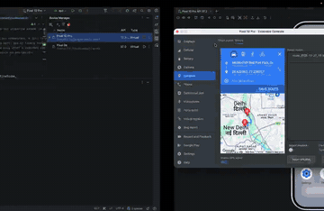
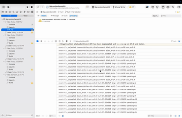

# React Native Background Location Pro

**Production-grade background location tracking for React Native that survives app kills, reboots, and offline periods, with no third-party tracking SDKs.**


Android and iOS are both shipping. Buy one platform or get both in the Best Value Edition — see [Get access](#-get-access). You can also run the [free evaluation package](#try-it-free-before-you-buy) in your own app first.

**From the author of [react-native-pdf-jsi](https://github.com/126punith/react-native-pdf-jsi)** — the JSI-powered PDF viewer and document toolkit for React Native:

[](https://www.npmjs.com/package/react-native-pdf-jsi)
[](https://www.npmjs.com/package/react-native-pdf-jsi)
[](https://github.com/126punith/react-native-pdf-jsi)

Same architecture, same approach to native code.

---

## The problem

If you have shipped background location on mobile, you have probably hit these:

- **The OS kills your app** and tracking silently stops, so nobody notices until the data has gaps.
- **Points are lost while offline**, in tunnels, basements, or on weak networks.
- **Uploads get duplicated** on retries, so your backend fills up with repeated points.
- **Battery drains** because every GPS fix is stored and sent, even when the phone isn't moving.
- **Tracking falls asleep mid-session.** Motion-driven SDKs decide a slow hiker or a phone in a bag is "stationary" and stop recording, leaving gaps in a workout or a delivery route.
- **Apps get rejected** by Apple and Google review over background-location disclosures, purpose strings, and declarations.

Most tracking SDKs are expensive, closed, or break on newer OS versions. This module solves these problems natively, and you own the code.

---

## Platform support

| | Android | iOS |
| --- | --- | --- |
| Status | **Shipping** | **Shipping** |
| Language | Kotlin | Swift + Objective-C++ bridge |
| Architecture | **New Architecture only** — TurboModule + JSI, no legacy bridge | **New Architecture only** — `codegenConfig.ios.modulesProvider` |
| Native layer | Kotlin foreground service + FusedLocationProvider | Swift `CLLocationManager` + `CLBackgroundActivitySession` (iOS 17+) |
| Bridge | JSI TurboModule | TurboModule via Objective-C++ (`RCTLocationTracker`) |
| Offline queue | Room | System `sqlite3` |
| Motion gate (`adaptive_low_power`) | `SensorManager` significant motion + accelerometer; Activity Recognition (opt-in) | `CMMotionActivityManager` + `CMPedometer` |
| Self-healing | `START_STICKY` service + `AlarmManager` watchdog + boot / update receivers | Significant-change relaunch + `BGAppRefreshTask` + heartbeat watchdog |

Built and tested on React Native 0.88 with the New Architecture enabled. There is no Paper /
legacy-bridge path on either platform — the module is codegen-driven on both sides and no
`NativeModules` shim is involved. Both platforms share the same core JS API; iOS adds
`requestLocationPermission` and authorization status fields (When-In-Use / Always, precise location).

Unlike Android, iOS has no foreground service. Background collection depends on the `location`
background mode and the **Always** authorization; this is a platform constraint, not an
implementation shortcut, and it is documented in the iOS build's own README.

---

## Pick your tracking profile

One line of JS, applied live with no restart: `LocationTracker.setTrackingProfile('continuous_fitness')`.

| Profile | Behavior | Use it for |
| --- | --- | --- |
| `continuous_fitness` | **Never sleeps on its own.** Bound strictly to a 5 m distance filter until your code calls `stopTracking()`. iOS runs with `CLActivityType.fitness` and automatic pausing hard-disabled. | Hiking, running and cycling apps, and any session the user starts and stops explicitly |
| `adaptive_low_power` (default) | Native motion sensors park the GPS chip while the device is confidently stationary and wake it on movement. Built on OS sensor APIs only, with no third-party SDK. | Delivery, field-service and fleet apps that track all day |
| `balanced` | Always subscribed, 20 m displacement gate. | Everything else |

**The motion gate fails open.** If a sensor is missing, the user denies Motion & Fitness, or a vendor ROM blocks the trigger, the engine falls back to always-on GPS. It never pauses silently. Parking GPS requires two independent signals for two minutes: the motion sensors report still, **and** the location stream has recorded no movement. A slow hiker keeps producing movement, so the gate cannot park them.

---

## Key capabilities

- **Keeps tracking with the app closed.** It runs as a native service, independent of the JS layer — a Kotlin foreground service on Android, `CLLocationManager` with background mode on iOS.
- **Self-healing.** Tracking restarts on its own after a crash, a phone reboot, or an app update. On iOS this needs **Always** location permission, and iOS never relaunches an app the user force-quit from the app switcher until it is opened again.
- **Offline-first.** Every point is saved on the device first, so nothing is lost without network.
- **No duplicate uploads.** Batched sync stays safe across retries and flaky connections.
- **Battery-friendly smart filtering.** Only meaningful movement is recorded, and under `adaptive_low_power` the GPS chip is switched off while the device is stationary.
- **Bulletproof native sync.** Retries, backoff and network changes are handled in Kotlin and Swift with no JS involved. See [Native sync guarantees](#native-sync-guarantees).
- **Store approval blueprints.** Copy-paste manifest, `Info.plist` and privacy-manifest templates, plus disclosure text and reviewer notes. See [Store approval blueprint](#store-approval-blueprint-included).
- **Live map dashboard.** Includes a backend with a real-time map to watch devices move.
- **Modern React Native.** Built on the New Architecture (JSI / TurboModule) with a typed API.

---

## Tested scenarios

Android:

| Scenario | Result |
| --- | --- |
| Airplane mode for several minutes while moving | Passed: all points delivered after reconnecting |
| App process killed by the system | Passed: tracking resumes automatically |
| Phone rebooted without opening the app | Passed: tracking resumes automatically |
| App updated to a new version | Passed: tracking resumes automatically |
| Phone idle for a long period | Passed: no junk points, tracking stays alive |
| Flaky or captive-portal network | Passed: data held safely until a real connection |
| Repeated uploads of the same data | Passed: zero duplicates on the server |

iOS: offline buffering and duplicate-free uploads behave the same way. Recovery after a reboot or a
system kill relies on **Always** permission (significant-change relaunch), and a user force-quit stops
tracking until the app is reopened — an iOS rule that applies to every app.

---

## Demo

Short clips from the reference implementation. Both platforms use the same core JS API and the same
ingestion server, so the dashboard output is identical.

<table>
<tr>
<td width="50%" align="center">

**Android** — Kotlin foreground service

<a href="assets/demo.mp4">
  
</a>

[Watch the Android demo (MP4)](assets/demo.mp4)

</td>
<td width="50%" align="center">

**iOS** — Swift `CLLocationManager`

<a href="assets/demo-ios.mp4">
  
</a>

[Watch the iOS demo (MP4)](assets/demo-ios.mp4)

</td>
</tr>
</table>

What the demo shows: tracking started in the foreground, then the app is backgrounded and the process
is killed by the system. Points keep landing on the live map, and the queue drains on reconnect.

---

## Native sync guarantees

Uploads run entirely in the native layer, detached from JavaScript state, so they keep working with the React instance torn down.

- **Offline-first.** Every accepted fix is written to SQLite (Room on Android) before anything else happens.
- **Idempotent batches.** Each batch keeps its `Idempotency-Key` until the server acknowledges it, so retries never create duplicates.
- **Classified retries.** Timeouts, 408, 425, 429 and 5xx back off exponentially (5 s, 10 s, 20 s and so on up to a configurable cap) with jitter, so a fleet that reconnects together does not hit your server in lockstep.
- **`Retry-After` respected.** A 429 or 503 with `Retry-After` waits exactly as long as your server asks.
- **Auth errors never drop data.** 401 and 403 keep every point and retry at the cap until the configuration is fixed.
- **Dead-letter queue.** A batch your server keeps rejecting (for example 400 or 422) can be set aside after `maxAttempts`, so one bad payload never blocks the rest of the queue. The rows are kept for inspection.
- **Survives process death.** Retry state is persisted, so a killed app resumes the same backoff schedule instead of restarting it.
- **Network-aware.** Native connectivity monitors (`ConnectivityManager` with validated networks, `NWPathMonitor`) hold uploads while offline or behind a captive portal, then flush the moment a real connection returns.
- **Observable.** `getStatus()` exposes `retryAttempt`, `nextRetryAt`, `lastSyncError` and the dead-letter count.

```ts
LocationTracker.setSyncPolicy(/* batchSize */ 50, /* maxBackoffMs */ 120_000, /* maxAttempts */ 5);
```

---

## Store approval blueprint included

Background location is among the most-rejected permissions on both stores. Each edition ships a review guide for its platform:

| | Android Edition | iOS Edition |
| --- | --- | --- |
| Guide | `docs/review/ANDROID_REVIEW_BLUEPRINT.md` | `docs/review/IOS_REVIEW_BLUEPRINT.md` |
| Templates | Production `AndroidManifest.xml`, every permission annotated | `Info.plist` purpose strings, `PrivacyInfo.xcprivacy` with location declared |
| Covers | Prominent-disclosure text, Play Console location and foreground-service declarations, Data safety answers, a shot list for the review video | Feature-specific purpose strings, the progressive Always flow, background-mode hygiene, App Privacy label |
| Plus | Common rejection reasons with the fix for each, and a reviewer-notes template | Common rejection reasons with the fix for each, and a review-notes template |

---

## How it compares

Each table below covers one category, so you can compare on what matters to your team. Competitor details reflect their public documentation as of Q4 2026; check before relying on them.

<details open>
<summary><b>Reliability</b></summary>

| | Background Location Pro | Transistorsoft `react-native-background-geolocation` | `expo-location` + `expo-task-manager` |
| --- | --- | --- | --- |
| Native pipeline independent of JS | Yes | Yes | No (background work runs a JS task) |
| Restart after crash, reboot and app update | Yes (Android); iOS with Always | Yes | No built-in restart |
| Never-sleep session mode | `continuous_fitness` profile | Configurable (`disableStopDetection`) | Not applicable (no stop detection) |
| Default when motion detection is unavailable | Fails open, GPS stays live | Vendor-defined | Not applicable |

</details>

<details>
<summary><b>Battery strategy</b></summary>

| | Background Location Pro | Transistorsoft | `expo-location` |
| --- | --- | --- | --- |
| Stationary detection | OS sensors: significant motion, accelerometer, CoreMotion, optional Activity Recognition | Motion-activity state machine | None built in |
| Extra permission needed by default | None on Android; Motion & Fitness on iOS | Motion permission | Not applicable |
| Battery profiles | 3, switchable live | Configurable presets | Accuracy setting only |

</details>

<details>
<summary><b>Data guarantees</b></summary>

| | Background Location Pro | Transistorsoft | `expo-location` |
| --- | --- | --- | --- |
| Offline on-device queue | Yes (SQLite / Room) | Yes | Build it yourself |
| Native HTTP sync | Yes | Yes | Build it yourself |
| Idempotent batch uploads | Yes, built in | Server-side de-duplication is up to you | Build it yourself |
| `Retry-After` and dead-letter queue | Yes | Not documented | Build it yourself |

</details>

<details>
<summary><b>Store compliance</b></summary>

| | Background Location Pro | Transistorsoft | `expo-location` |
| --- | --- | --- | --- |
| Review guide with templates | Yes, per platform | General setup docs | Permission docs |
| Disclosure and reviewer-notes copy | Yes | No | No |

</details>

<details>
<summary><b>Ownership and cost</b></summary>

| | Background Location Pro | Transistorsoft | `expo-location` |
| --- | --- | --- | --- |
| Native source code | **Full source, yours to modify** | Compiled native libraries | Open source |
| Pricing | One-time, from $39 | Per-app commercial license | Free |
| Third-party tracking SDKs | None | Is the SDK | None |
| Free trial | Full engine in your own app, debug builds, no time limit | Per vendor terms | Not applicable (free) |

</details>

---

## What's included

Every edition includes:

- The React Native JS API (typed TurboModule spec) and a ready-to-use live dashboard screen
- Three tracking profiles (`continuous_fitness`, `adaptive_low_power`, `balanced`) with the native motion gate
- The store approval blueprint for your platform
- A backend ingestion server with a real-time live map, and fault injection for testing retries
- A setup and run guide
- Lifetime updates to the repositories you bought

Plus, per edition:

| Edition | Native code | Private repository access |
| --- | --- | --- |
| **Android Edition** | Complete Android tracking module (Kotlin, New Architecture) | Android repository |
| **iOS Edition** | Complete iOS tracking module (Swift + Objective-C++ TurboModule) | iOS repository |
| **Best Value Edition** | Both modules | Both repositories |

---

## What's new in v2

- **Tracking profiles**, switchable live: `continuous_fitness` never sleeps, and `adaptive_low_power` parks GPS while stationary.
- **Native motion gate** on OS sensor APIs only: significant motion, accelerometer and optional Activity Recognition on Android; CoreMotion and the pedometer on iOS.
- **Sync hardening**: classified retries, `Retry-After`, jitter, an auth-safe policy, a dead-letter queue, and retry state that survives process death.
- **Store approval blueprints** for Play and App Store review.
- **Safer database upgrades**: schema changes now migrate in place instead of risking buffered points.
- **Default changed**: new installs use `adaptive_low_power`. Call `setTrackingProfile('balanced')` to keep the v1 behavior.

---

## Try it free before you buy

Don't take the demo videos on faith. A free evaluation build of the **complete native engine** is
published on npm, so you can run it inside your own app, on your own routes and devices, before you
spend anything.

[](https://www.npmjs.com/package/react-native-background-location-pro-eval)
[](https://www.npmjs.com/package/react-native-background-location-pro-eval)

```sh
npm i react-native-background-location-pro-eval
cd ios && pod install
```

```ts
import LocationTracker from 'react-native-background-location-pro-eval';

LocationTracker.startTracking('https://your-server.example.com');

const status = LocationTracker.getStatus(); // synchronous, over JSI
```

### What the eval package actually is

It is not a mock, a stub, or a cut-down demo screen. It is the production engine **compiled and
shipped as binaries** — `bgtrackkit.aar` on Android, `BgTrackKit.xcframework` on iOS — with only the
thin TurboModule bridge left as readable source. Your app links the real thing.

| | What the eval build runs |
| --- | --- |
| Same native pipeline | `CLLocationManager` / `FusedLocationProvider` capture, displacement and teleport filtering, SQLite (Room on Android) buffering, idempotent batch sync, motion gate, watchdog |
| Same JS API | The identical typed TurboModule spec: `startTracking`, `stopTracking`, `getStatus`, `syncNow`, `setTrackingProfile`, `setSyncPolicy`, `setDemoMode`, `requestLocationPermission`, plus the `onLocationUpdate` / `onSyncStatus` event emitters |
| Same profiles | `continuous_fitness`, `adaptive_low_power` (default) and `balanced`, all switchable live |
| Zero app wiring | No `AppDelegate` edits and no module registration. Android autolinks through `react-native.config.js`; iOS registers itself from `+load` and boots on `UIApplicationDidFinishLaunching`, including headless relaunches |
| Debug builds only | Runs the full engine in debug builds, including crash, reboot and airplane-mode recovery. No time limit, no watermark |
| Requirements | New Architecture enabled (TurboModule codegen), Android `minSdkVersion` 24, iOS 15.1+ |

### What stops when you ship

Production and store builds are gated, deliberately and visibly:

- `getStatus().buildTier` reports **`'debug'`** in development and **`'release'`** in a production build.
- On Android the engine reads its own `FLAG_DEBUGGABLE`; if the flag is absent, `startTracking()` returns without starting, the service and the `AlarmManager` watchdog stay dead, and the status message carries a stable **`[eval_release_blocked]`** code pointing at the sponsor page.
- On iOS the framework selects a release profile at load time, so a Release/Archive build never revives tracking, including through significant-change relaunch.
- Nothing silently "works but doesn't upload". Tracking is off, and the reason is reported.

So the eval build is free for as long as you are evaluating. A license replaces the binaries with
full source you own and modify, plus the setup guide, the store approval blueprint, the ingestion
server and the live map.

### What the eval package does not include

The tarball ships JS types, the bridge sources and the two binaries — nothing more:

- No Kotlin/Swift engine source, no backend server, no dashboard, no store-review templates.
- iOS `Info.plist` keys are yours to add: `UIBackgroundModes` (including `location`),
  `BGTaskSchedulerPermittedIdentifiers`, and the location and motion usage strings. The package
  README lists them.
- No Expo config plugin: add the `Info.plist` keys yourself in your dev build.

Governed by a [commercial evaluation license](https://www.npmjs.com/package/react-native-background-location-pro-eval):
run it free in development builds, but no redistribution, no decompiling or reverse engineering, and
no removing or circumventing the gate.

> Already convinced? Skip to [Get access](#-get-access) for the full source.

---

## 🚀 Get access

Pay once, no subscription. Pick an edition, then the payment option that matches your location.

| Edition | What you get | USD (GitHub Sponsors) | INR (UPI) |
| --- | --- | --- | --- |
| **Android Edition** | Android module + JS API + server | **$39** | **₹3,000** |
| **iOS Edition** | iOS module + JS API + server | **$59** | **₹5,000** |
| **Best Value Edition** ⭐ | Android + iOS, both repositories | **$89** (save $9) | **₹7,000** (save ₹1,000) |

### 🌎 Option A: International developers (outside India), via GitHub Sponsors

Pay securely through GitHub Sponsors with any credit card, debit card, or PayPal.

👉 **[Sponsor on GitHub (one-time)](https://github.com/sponsors/126punith)**

> **Important:** choose the **One-time** tab and select the tier for your edition: **$39** (Android), **$59** (iOS), or **$89** (Best Value). Do **not** pick a monthly sponsorship. This is a single payment, not a subscription.

**How access works**

1. Open the link above, switch to **One-time**, and complete the sponsorship for your edition.
2. I personally confirm that your sponsorship and payment have come through.
3. I then add your GitHub account as a collaborator to the repository (or both repositories for Best Value) that matches your tier, usually within 24 hours.
4. Accept the invite from your email or from [github.com/notifications](https://github.com/notifications).

*No need to send your username, because GitHub shows me which account sponsored and which tier. If you sponsored from a different account than the one you want access on, email [punithm300@gmail.com](mailto:punithm300@gmail.com).*

### 🇮🇳 Option B: Indian developers (UPI / GPay)

Pay directly via UPI: **₹3,000** (Android), **₹5,000** (iOS), or **₹7,000** (Best Value).

1. Scan the QR code below with any UPI app (GPay, PhonePe, Paytm).
2. Enter the amount for your edition and make a one-time payment.
3. Email a screenshot of the successful payment, the **edition** you bought, and your **GitHub username** to **[punithm300@gmail.com](mailto:punithm300@gmail.com)**.
4. You'll be added as a collaborator to the matching private repository (or both for Best Value) after the payment is verified.

<p align="center">
  
</p>

---

## FAQ

**Is this a subscription?**
No. Every edition is a one-time payment with lifetime access to its repository and updates. On GitHub Sponsors, make sure you pick the one-time tier ($39, $59, or $89), not a monthly one.

**Which edition should I buy?**
Buy the Android or iOS Edition if your app ships on one platform. If you ship on both, the Best Value Edition costs less than buying the two separately.

**Can I try it before paying?**
Yes. Install `react-native-background-location-pro-eval` and the full native engine runs in your development builds with no time limit. Production and store builds report `buildTier: 'release'` and stay off until you license the source. See [Try it free before you buy](#try-it-free-before-you-buy).

**Can I use it in commercial apps?**
Yes. You can use it in personal and commercial projects.

**Can I share or resell the code?**
No. Redistributing, reselling, or publishing the source code is not allowed.

**Does it support iOS?**
Yes. iOS is shipping: buy the iOS Edition on its own, or the Best Value Edition for Android and iOS together.

**I paid but haven't got access yet.**
Email [punithm300@gmail.com](mailto:punithm300@gmail.com) with your GitHub username, the edition you bought, and a Sponsors receipt or UPI screenshot.

---

## License

### Commercial Source License Agreement

Copyright (c) 2026 Punith Manthri. All rights reserved.

By purchasing, downloading, or accessing the source code of **React Native Background Location Pro** (the "Software"), you (the "Licensee") agree to be bound by the terms and conditions of this Commercial Source License Agreement.

#### 1. Grant of License

Subject to a valid one-time payment, the Licensor (Punith Manthri) grants the Licensee a perpetual, non-exclusive, worldwide, non-transferable license to:

- Use, modify, and integrate the Software source code into personal projects.
- Use, modify, and integrate the Software source code into commercial/production applications owned by the Licensee or built for a single corporate client.

#### 2. Restrictions & Prohibitions

The Licensee is strictly forbidden from engaging in the following actions:

- **No Redistribution:** You cannot redistribute, publish, upload to public repositories (such as public GitHub repos), or make the underlying source code accessible to third parties.
- **No Reselling:** You cannot resell, sub-license, rent, lease, or commercially exploit the Software source code as a standalone asset, template, module, or starter kit.
- **No Sublicensing:** A single purchase covers one individual developer or organization. You cannot purchase one copy and distribute the source code across an entire external network of independent developers.

#### 3. Intellectual Property

The Software and all native source blueprints (including Kotlin and Swift modules, JSI bindings, and Express backend telemetry configurations) are and remain the exclusive intellectual property of the Licensor.

#### 4. Termination

Any breach of this License Agreement automatically terminates your rights under this license. Upon termination, you must immediately cease using the Software and securely delete all copies of the source code in your possession.

#### 5. Limitation of Liability

The Software is provided "as is", without warranty of any kind, express or implied. In no event shall the Licensor be liable for any claim, damages, or other liability arising from, out of, or in connection with the Software.
