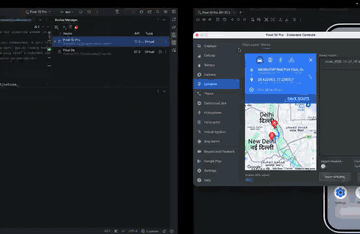

# React Native Background Location Pro

**Production-grade background location tracking for React Native (Android) that survives app kills, reboots, and offline periods, with no third-party tracking SDKs.**

---

## The problem

If you have shipped background location on Android, you have probably hit these:

- **The OS kills your app** and tracking silently stops, so nobody notices until the data has gaps.
- **Points are lost while offline**, in tunnels, basements, or on weak networks.
- **Uploads get duplicated** on retries, so your backend fills up with repeated points.
- **Battery drains** because every GPS fix is stored and sent, even when the phone isn't moving.

Most tracking SDKs are expensive, closed, or break on newer Android versions. This module solves these problems natively, and you own the code.

---

## Key capabilities

- **Keeps tracking with the app closed.** It runs as a native Kotlin foreground service, independent of the JS layer.
- **Self-healing.** Tracking restarts on its own after a crash, a phone reboot, or an app update.
- **Offline-first.** Every point is saved on the device first, so nothing is lost without network.
- **No duplicate uploads.** Batched sync stays safe across retries and flaky connections.
- **Battery-friendly smart filtering.** Only meaningful movement is recorded.
- **Live map dashboard.** Includes a backend with a real-time map to watch devices move.
- **Modern React Native.** Built on the New Architecture (JSI / TurboModule) with a typed API.

---

## Tested scenarios

| Scenario | Result |
| --- | --- |
| Airplane mode for several minutes while moving | Passed: all points delivered after reconnecting |
| App process killed by the system | Passed: tracking resumes automatically |
| Phone rebooted without opening the app | Passed: tracking resumes automatically |
| App updated to a new version | Passed: tracking resumes automatically |
| Phone idle for a long period | Passed: no junk points, tracking stays alive |
| Flaky or captive-portal network | Passed: data held safely until a real connection |
| Repeated uploads of the same data | Passed: zero duplicates on the server |

---

## Demo

  

<a href="assets/demo.mp4"><b>Watch the full demo video (MP4)</b></a>

---

## What's included in the private repository

- The complete native Android tracking module (Kotlin)
- The React Native JS API and a ready-to-use live dashboard screen
- A backend ingestion server with a real-time live map
- A step-by-step setup and integration guide
- Lifetime updates to the repository

---

## 🚀 Get access

Pay once to get access to the complete private repository. Choose the option that matches your location.

### 🌎 Option A: International developers (outside India)

Pay with any international credit card, debit card, or PayPal.

👉 **[Purchase via Gumroad ($39 USD)](YOUR_GUMROAD_LINK)**

*Enter your GitHub username at checkout. You'll be added to the private repository within 24 hours.*

### 🇮🇳 Option B: Indian developers (UPI / GPay)

Pay directly via UPI: **₹3,000 INR**.

1. Scan the QR code below with any UPI app (GPay, PhonePe, Paytm).
2. Make a one-time payment of **₹3,000**.
3. Email a screenshot of the successful payment along with your **GitHub username** to **[punithm300@gmail.com](mailto:punithm300@gmail.com)**.
4. You'll be added as a collaborator to the private repository after the payment is verified.

  

---

## FAQ

**Is this a subscription?**
No. It's a one-time payment with lifetime access to the repository and its updates.

**Can I use it in commercial apps?**
Yes. You can use it in personal and commercial projects.

**Can I share or resell the code?**
No. Redistributing, reselling, or publishing the source code is not allowed.

**Does it support iOS?**
The current release targets Android. Email me if you need iOS.

**I paid but haven't got access yet.**
Email [punithm300@gmail.com](mailto:punithm300@gmail.com) with your payment details and GitHub username.

---

## License

Commercial license. A purchase grants one buyer the right to use the code in their own projects. Redistributing or reselling it is prohibited. © Punith Manthri. All rights reserved.
